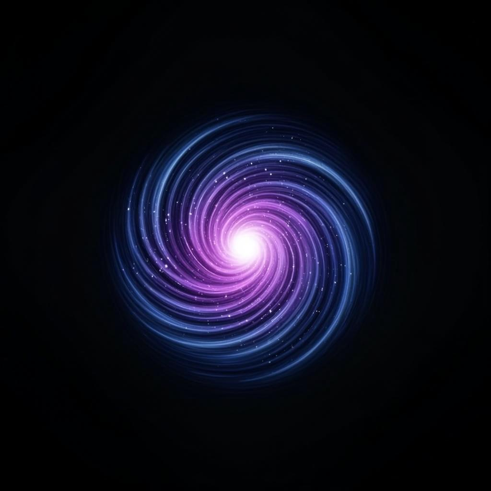
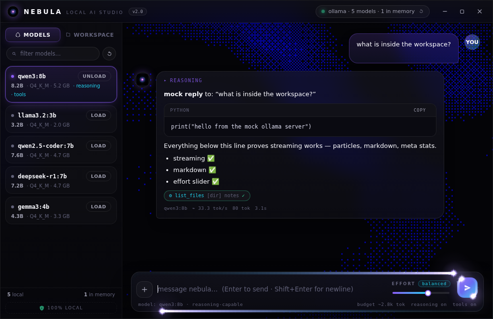

# NEBULA — local AI studio for Ollama

<p align="center">
  
</p>

**Nebula** is a tiny (≈2 MB) native desktop app that turns **[Ollama](https://ollama.com)** into a beautiful, particle-driven chat studio. No cloud, no accounts, no telemetry — everything runs on your machine.



## ✨ Features

- **Real Ollama integration** — auto-discovers every model installed on your computer (`/api/tags`), shows which ones are loaded in memory (`/api/ps`) and lets you **load / unload models into memory** with one click.
- **Streaming chat** with markdown rendering, syntax-highlighted code blocks (one-click copy) and live tok/s stats.
- **Reasoning support** — thinking tokens from models like `qwen3` / `deepseek-r1` appear in a collapsible *reasoning* panel.
- **🪐 Effort slider** — the more effort, the thicker/faster the star particles around the UI get, the bigger the token budget (`num_predict`), and reasoning turns on for capable models.
- **📁 Workspace tools** — attach any folder or file and the AI can *work inside it*: `list_files`, `read_file`, `write_file`, `search_files` (for tool-capable models). Files without tool support get inlined as context instead. Paths are sandboxed to the workspace root.
- **Particle UI** — WebGL2 dithered nebula background (ReactBits `Dither` port) + animated StarBorder comets orbiting the composer and send button (ReactBits `StarBorder` port), both tuned in vanilla JS.
- **Splash screen** with generated nebula artwork and a loading bar.
- **Chat history, model and workspace persist** between sessions (localStorage).

## 🚀 Quick start (Windows)

1. Install [Ollama](https://ollama.com/download) and pull a model, e.g. `ollama pull qwen3:8b`
2. Make sure Ollama is running (`ollama serve`, or the tray app)
3. Unzip the release and run **`Nebula.exe`**
4. Pick a model on the left → chat

## 🛠 Building from source

```bash
npm i -g @neutralinojs/neu
neu update          # fetch binaries + client library
neu run             # dev mode
neu build --release # → dist/Nebula/Nebula-win_x64.exe (+ linux/mac binaries)
```

## 🧪 Headless QA

The `dev/` folder contains a mock Ollama server and a Neutralino browser shim so the whole UI can be tested without a display:

```bash
node dev/mock-ollama.mjs   # fake Ollama on :11434
node dev/serve.mjs         # harness on :8123 (injects dev/shim.js)
```

## 📦 Tech

- [Neutralino.js](https://neutralino.js.org) — 2 MB native window, no Electron/Node runtime bundled
- Vanilla JS ports of ReactBits [`StarBorder`](https://reactbits.dev) + [`Dither`](https://reactbits.dev)
- Ollama REST API: `/api/tags`, `/api/ps`, `/api/show`, `/api/chat` (streaming + tools), `/api/generate`

## ⚠️ Notes

- Nebula only talks to `http://127.0.0.1:11434` — nothing ever leaves your machine.
- Tool-capable models (e.g. `qwen3`, `llama3.1+`, `qwen2.5-coder`) can *edit files* in the workspace you attach. Attach folders you're comfortable letting the model modify.


MIT © 2026 flexyfresh8-prog
